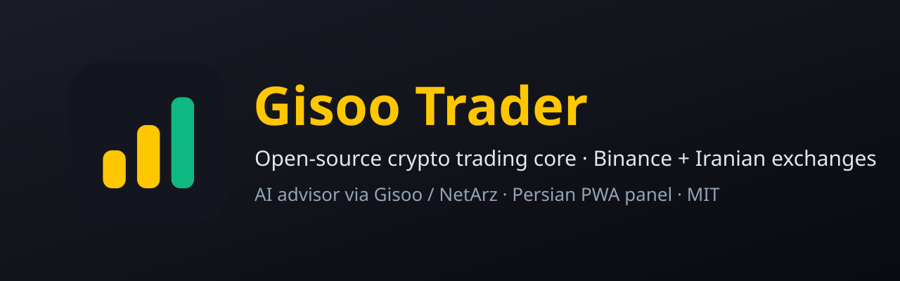

<div align="center">



# گیسو تریدر | Gisoo Trader

**هسته‌ی متن‌باز ربات معامله‌گر رمزارز، با اتصال به بایننس و صرافی‌های ایرانی، مشاور هوش مصنوعی از طریق
[گیسو](https://gisoo.pro/?utm_source=github&utm_medium=referral&utm_campaign=gisoo-trader&utm_content=header) و
[نِت اَرز](https://netarz.ir/?utm_source=github&utm_medium=referral&utm_campaign=gisoo-trader&utm_content=header)، و پنل فارسی.**

[](https://github.com/ARaminco/gisoo-trader/actions/workflows/ci.yml)
[](LICENSE)
[](https://gisoo.pro/?utm_source=github&utm_medium=referral&utm_campaign=gisoo-trader&utm_content=badge)
[](https://netarz.ir/?utm_source=github&utm_medium=referral&utm_campaign=gisoo-trader&utm_content=badge)

</div>

> [!WARNING]
> **این یک هسته‌ی اولیه برای توسعه است، نه محصول آماده‌ی سرمایه‌گذاری و نه مشاوره‌ی مالی.**
> مسئولیت کامل نصب، تنظیم و استفاده، و هر سود یا زیانی که پیش بیاید، با خود شماست. معامله‌ی رمزارز پرریسک است و
> ممکن است همه‌ی سرمایه‌ای را که به ربات می‌سپارید از دست بدهید. اتصال صرافی‌های ایرانی آزمایشی است.
> پیش از هر کاری [سلب مسئولیت](DISCLAIMER.md) را بخوانید.

## گیسو تریدر چیست؟

یک ربات معامله‌گر خودکار و متن‌باز که روی سرور یا رایانه‌ی خودتان با Docker اجرا می‌شود. کلید صرافی فقط پیش خودتان
است و هیچ سرویس بیرونی به پول شما دسترسی ندارد.

- **استراتژی ۴ ساعته‌ی پرتفوی:** مومنتوم مقطعی (سه ارز قوی‌تر) و شکست کانال ۵۵/۲۰، با فیلتر روند بیت‌کوین
  (میانگین ۲۰۰ کندلی). روی دوازده دوره‌ی تاریخی بازار ۲۰۲۱ تا ۲۰۲۶ آزموده شده؛ نتیجه‌ی گذشته تضمینی برای آینده نیست.
- **مدیریت ریسک سخت‌گیرانه:** حد ضرر برای هر معامله، سقف ضرر روزانه، توقف اضطراری با افت ۲۰ درصدی، سقف تعداد پوزیشن.
- **اتصال به چند صرافی:** بایننس و صرافی‌های ایرانی نوبیتکس، والکس، بیت‌پین، رمزینکس و اوکی اکسچنج؛ بازارهای تتری
  و تومانی.
- **مشاور هوش مصنوعی (اختیاری):** با یک کلید [گیسو](https://gisoo.pro/?utm_source=github&utm_medium=referral&utm_campaign=gisoo-trader&utm_content=features)
  یا [وب‌سرویس هوش مصنوعی نِت اَرز](https://netarz.ir/ai-api?utm_source=github&utm_medium=referral&utm_campaign=gisoo-trader&utm_content=features)
  به صدها مدل (GPT، Claude، Gemini، DeepSeek) با اعتبار تومانی. هوش مصنوعی فقط می‌تواند معامله را رد یا کوچک کند،
  هرگز خودش معامله باز نمی‌کند. «کمیته‌ی سرمایه‌گذاری» روزی دو بار گزارش فارسی می‌نویسد.
- **ارزش حساب به تومان:** با [وب‌سرویس نرخ ارز نِت اَرز](https://netarz.ir/fx-api?utm_source=github&utm_medium=referral&utm_campaign=gisoo-trader&utm_content=features).
- **پنل فارسی (PWA):** نصب روی گوشی، داشبورد، سیگنال‌ها، معاملات، بک‌تست، راهنمای قدم‌به‌قدم، اعلان تلگرام و
  Web Push، ورود دومرحله‌ای و کلید امنیتی (Passkey).
- **حالت آزمایشی (paper):** با قیمت واقعی و پول فرضی؛ پیش‌فرض نصب همین است.

## صرافی‌ها

| صرافی | `EXCHANGE` | وضعیت | حد ضرر |
|---|---|---|---|
| بایننس | `binance` | مرجع | سفارش استاپ روی صرافی |
| نوبیتکس | `nobitex` | آزمایشی | سفارش استاپ روی صرافی |
| والکس | `wallex` | آزمایشی | سفارش استاپ روی صرافی |
| بیت‌پین | `bitpin` | آزمایشی | سفارش استاپ روی صرافی |
| رمزینکس | `ramzinex` | آزمایشی | توسط خود ربات (ربات باید روشن بماند) |
| اوکی اکسچنج | `okex` | آزمایشی | سفارش استاپ روی صرافی |

«آزمایشی» یعنی از روی مستندات رسمی صرافی نوشته شده و داده‌ی بازارش واقعاً آزموده شده، ولی ثبت سفارش با پول واقعی
هنوز روی آن آزموده نشده است. جزئیات، واحدها (ریال و تومان) و محدودیت‌ها: [docs/exchanges.md](docs/exchanges.md).

## راه‌اندازی سریع

پیش‌نیاز: [Docker](https://docs.docker.com/get-docker/) (روی ویندوز Docker Desktop) و حدود ۴ گیگابایت حافظه.

```bash
git clone https://github.com/ARaminco/gisoo-trader.git
cd gisoo-trader
./start.sh            # لینوکس / مک
.\start.ps1           # ویندوز (PowerShell)
```

بار اول فایل `.env` با رمزهای تصادفی ساخته می‌شود. آن را باز کنید و دست‌کم این‌ها را تنظیم کنید، بعد دوباره اجرا کنید:

```dotenv
TRADING_MODE=paper            # پول فرضی؛ بعد از آزمودن: live
EXCHANGE=nobitex              # binance | nobitex | wallex | bitpin | ramzinex | okex
QUOTE_ASSET=USDT              # یا IRT برای بازارهای تومانی
PANEL_PASSWORD=...            # بهتر: PANEL_PASSWORD_HASH
# برای حالت live:
EXCHANGE_API_KEY=...
EXCHANGE_API_SECRET=...
# اختیاری:
GISOO_API_KEY=sk-gisoo-v1-...  # و LLM_ENABLED=true
NETARZ_FX_KEY=fx-ntz-v1-...
```

پنل: `http://localhost:8090`. همه‌ی تنظیمات با توضیح در [.env.example](.env.example) آمده است. راهنمای کامل
فارسی داخل خود پنل است (بخش «راهنما»).

### پیش از پول واقعی

1. چند روز در حالت `paper` اجرا کنید و رفتار ربات را ببینید.
2. کلید صرافی را **فقط با مجوز خواندن و معامله** بسازید، **هرگز با مجوز برداشت**، و اگر صرافی اجازه می‌دهد به IP
   سرور محدودش کنید.
3. `TAKER_FEE_PCT` را برابر کارمزد واقعی خودتان بگذارید.
4. با مبلغ کم شروع کنید و `TRADING_MODE=live` را بگذارید؛ بعد از پنل «مسلح» کنید (باید `ARM LIVE` را تایپ کنید).
5. پنل را فقط با HTTPS و ورود دومرحله‌ای در دسترس اینترنت بگذارید. پیش‌فرض فقط همین رایانه (`127.0.0.1`) است.

## هوش مصنوعی گیسو و نِت اَرز

| | گیسو | نِت اَرز |
|---|---|---|
| متغیر کلید | `GISOO_API_KEY` | `NETARZ_AI_API_KEY` |
| نشانی | `https://gisoo.pro/api/v1` | `https://netarz.ir/api/ai/v1` |
| مدل‌ها | بیش از ۴۰۰ مدل، هر شناسه‌ی مدل | GPT، Gemini، DeepSeek، Claude با پیشوند `openrouter/anthropic/` |
| خرید اعتبار | تومانی، [gisoo.pro](https://gisoo.pro/?utm_source=github&utm_medium=referral&utm_campaign=gisoo-trader&utm_content=ai) | تومانی، [netarz.ir/ai-api](https://netarz.ir/ai-api?utm_source=github&utm_medium=referral&utm_campaign=gisoo-trader&utm_content=ai) |

با `LLM_ENABLED=true` و `LLM_PROVIDER=auto`، اولین کلیدی که تنظیم شده باشد استفاده می‌شود. OpenAI، Anthropic و
DeepSeek هم مستقیم پشتیبانی می‌شوند. نمونه‌کدهای بیشتر: [netarz/gisoo](https://github.com/netarz/gisoo) و
[netarz/ai-api-examples](https://github.com/netarz/ai-api-examples).

## مستندات

- [معماری و جزئیات فنی](docs/architecture.md)
- [صرافی‌ها](docs/exchanges.md)
- [سیاست ریسک پیش‌فرض](docs/risk-policy.md)
- [سلب مسئولیت](DISCLAIMER.md) · [سیاست امنیتی](SECURITY.md) · [راهنمای مشارکت](CONTRIBUTING.md)

## مشارکت و پشتیبانی

این پروژه یک نقطه‌ی شروع است و از Pull Request استقبال می‌کنیم: اتصال صرافی تازه، گزارش اجرای واقعی اتصال‌های
آزمایشی، آزمون، مستندات و استراتژی‌هایی که با آزمون چنددوره‌ای پشتیبانی شوند. پیش از شروع
[راهنمای مشارکت](CONTRIBUTING.md) را بخوانید.

- **اشکال در کد:** در [Issues](https://github.com/ARaminco/gisoo-trader/issues) بنویسید (کلید و اطلاعات شخصی را حذف کنید).
- **مشکل امنیتی:** فقط به `dev@netarz.ir`؛ [سیاست امنیتی](SECURITY.md).
- **حساب و اعتبار گیسو و نِت اَرز:** از پنل نِت اَرز [تیکت بزنید](https://netarz.ir/tickets?utm_source=github&utm_medium=referral&utm_campaign=gisoo-trader&utm_content=support).

پروژه‌های متن‌باز دیگر نِت اَرز: [github.com/netarz](https://github.com/netarz) ·
[netarz.ir/open-source](https://netarz.ir/open-source?utm_source=github&utm_medium=referral&utm_campaign=gisoo-trader&utm_content=footer)

«نِت اَرز» و «گیسو» نماینده‌ی رسمی هیچ‌یک از صرافی‌ها یا شرکت‌هایی که نامشان در این مخزن آمده نیستند.
مجوز: [MIT](LICENSE).

---

<a id="english"></a>

## English

**Gisoo Trader** is an open-source, self-hosted crypto trading core: a 4h trend-following portfolio (cross-sectional
momentum + 55/20 channel breakout behind a BTC regime gate) with strict risk controls, connectors for Binance and the
Iranian exchanges **Nobitex, Wallex, Bitpin, Ramzinex and OK-EX**, an optional AI risk advisor through
[Gisoo](https://gisoo.pro/?utm_source=github&utm_medium=referral&utm_campaign=gisoo-trader&utm_content=english) or the
[NetArz AI API](https://netarz.ir/ai-api?utm_source=github&utm_medium=referral&utm_campaign=gisoo-trader&utm_content=english)
(OpenAI-compatible, hundreds of models, paid in Toman), Toman valuation through the
[NetArz FX API](https://netarz.ir/fx-api?utm_source=github&utm_medium=referral&utm_campaign=gisoo-trader&utm_content=english),
and a Persian PWA control panel. It runs as one `docker compose` stack; your exchange keys never leave your machine.

> **Use at your own risk.** This is a starting core for developers, not a finished product and not financial advice.
> You are solely responsible for any loss. The Iranian connectors are **beta** (written against the official API docs,
> public market data verified live, order placement not yet run with real money on every exchange). Run `paper` mode
> first, then a small amount. Never give the bot a key with withdrawal permission. See [DISCLAIMER.md](DISCLAIMER.md).

**Quick start:** `git clone https://github.com/ARaminco/gisoo-trader.git && cd gisoo-trader && ./start.sh`
(Windows: `.\start.ps1`), edit the generated `.env` (`TRADING_MODE=paper` by default, `EXCHANGE`, `QUOTE_ASSET`,
`PANEL_PASSWORD`), run again and open `http://localhost:8090`.

**Docs:** [architecture](docs/architecture.md) · [exchanges](docs/exchanges.md) · [risk policy](docs/risk-policy.md) ·
[security](SECURITY.md) · [contributing](CONTRIBUTING.md). Security reports: `dev@netarz.ir`. License: MIT.

NetArz and Gisoo are not official partners of any exchange or company named in this repository.
